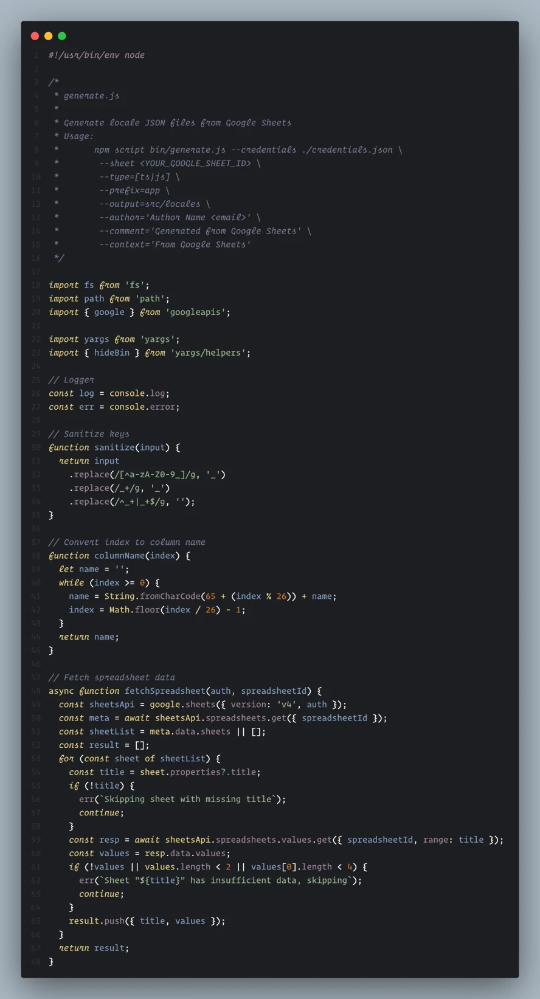

# VS Code CodePen Theme

A dark Visual Studio Code color theme inspired by the CodePen editor. Made with 🖤 by ziqq.

## Install

Install [CodePen Theme Original](https://marketplace.visualstudio.com/items?itemName=ziqq.codepen-theme-original) from the Visual Studio Code Marketplace, then select **CodePen Theme Original** from **Preferences: Color Theme**. It omits general theme-owned italics; annotations and decorators are the deliberate exception. Select **CodePen Theme Original Italics** for the same palette with the full italic syntax layer. **CodePen Theme Custom** keeps the CodePen palette with a GitHub-inspired role hierarchy and no theme-owned italics; **CodePen Theme Custom Italics** adds its italic syntax layer. Version `1.0.0` requires Visual Studio Code `1.96.0` or newer.

## Highlights

- Classic CodePen Twilight colors for TextMate and semantic tokens.
- Contextual syntax refinement for ambiguous local bindings and syntax roles.
- Provider-owned language grammars with verified compatibility baselines.
- Two theme families: Original follows the measured CodePen Twilight roles; Custom
  uses yellow types and selected atoms, blue declarations, annotations, module
  directives, and control flow, purple callables, and white values and members.
- Each family has an Italics variant with identical foreground and workbench colors.

## Documentation

- [Configuration](docs/configuration.md): variants, typography defaults, and highlighting controls.
- [Language support](docs/language-support.md): recommended providers and compatibility boundaries.
- [Highlighting](docs/highlighting.md): Original roles, semantic tokens, and contextual refinement.
- [Highlighting: Custom](docs/highlighting-custom.md): the Custom role hierarchy.
- [Migration from 0.12.x](MIGRATION.md): breaking language-provider changes in version 1.0.0.
- [Development guide](docs/development.md): generated-theme workflow, local checks, preview, and compatibility testing.
- [Screenshot gallery](docs/screenshots.md)
- [Compatibility contract](https://github.com/ziqq/vscode_codepen_theme/blob/master/compatibility/README.md)
