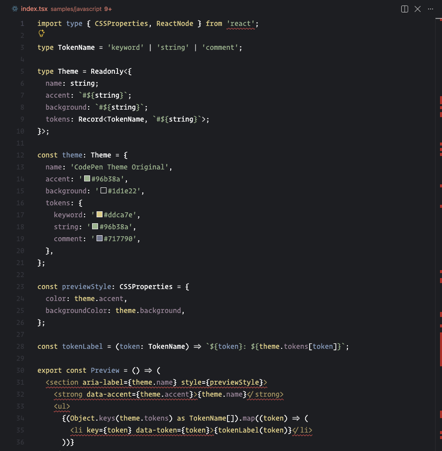
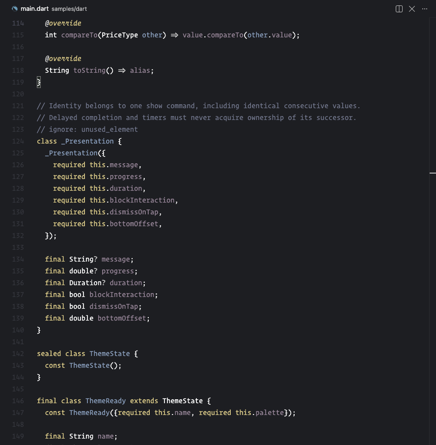

# CodePen Theme Original

A dark Visual Studio Code theme inspired by CodePen's classic Twilight palette. Made with 🖤 by ziqq.



## Install

Install [CodePen Theme Original](https://marketplace.visualstudio.com/items?itemName=ziqq.codepen-theme-original) from the Visual Studio Code Marketplace. Open **Preferences: Color Theme** and select:

- **CodePen Theme Original** — the classic palette without general syntax italics. Annotations and decorators retain their italic style.
- **CodePen Theme Original Italics** — the same colors with the full italic syntax layer.

Version **1.0.0** requires **VS Code 1.96.0 or newer**. Upgrading from 0.12.x? Read the [migration guide](MIGRATION.md) for the language-provider changes.

### Install a VSIX

Download `codepen-theme-original.vsix` from [GitHub Releases](https://github.com/ziqq/vscode_codepen_theme/releases), then run:

```sh
code --install-extension ./codepen-theme-original.vsix --force
```

You can also use **Extensions: Install from VSIX…** in the Command Palette. Select the theme after installation.

## Highlighting

- Classic Twilight colors for keywords, strings, numbers, comments, and punctuation.
- Contextual refinement keeps ambiguous variables, constants, fields, and methods distinct.
- Dart constants are blue; class fields and methods are purple. Annotation markers are gray, with yellow italic names.
- TextMate and semantic highlighting work with the same palette in both variants.

The theme uses language grammars supplied by VS Code and recommended extensions. Install the providers listed in [language support](docs/LANGUAGE-SUPPORT.md) for languages such as Dart, Go, Vue, Svelte, and TOML. Language-server features may also require their SDKs; installing the theme does not install them.

Contextual refinement is enabled by default. See [configuration](docs/CONFIGURATION.md) to change typography or highlighting settings, and [highlighting](docs/HIGHLIGHTING.md) for the color rules and refinement boundaries.

## Screenshots

These previews show **CodePen Theme Original** from the packaged extension in VS Code, with contextual refinement enabled.

### Dart



See the [full screenshot gallery](docs/SCREENSHOTS.md) for HTML, SCSS, Sass, TypeScript/React, Dart, Go, Python, Rust, TOML, Java, Just, SQL, and dotenv.

## Development

The [development guide](docs/DEVELOPMENT.md) covers building the VSIX, running checks, and testing the theme in an isolated editor. The [compatibility contract](https://github.com/ziqq/vscode_codepen_theme/blob/master/compatibility/README.md) records provider versions, source fixtures, and verification boundaries.
